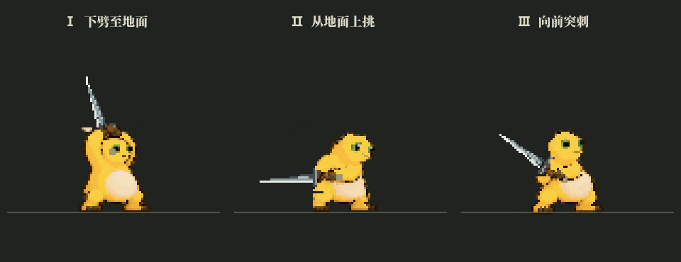
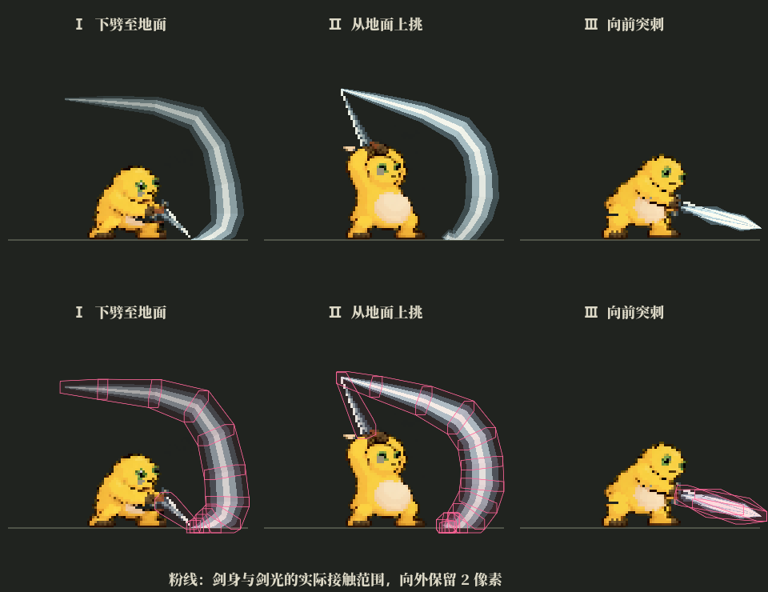

# 剑光与接触判定

剑攻击已恢复为制作人指定的 v8 动图版本，原来的 24 张人物 PNG 保持原样，运行时直接切换完整帧；第三段按制作人后续决定归类为突刺。

人物清单为 `data/sword_frames_v8.json`，已恢复原来的帧序、时间、96×96 画布及 [48,84] 锚点。收招后播放原人物闲置。刀光依次为下劈、上挑、突刺，武器描述同步更新。

## 可见区域

- 下劈：沿实际剑刃轨迹从上向下展开，最下端裁到脚底地面。
- 上挑：从地面开始，沿剑刃挑起轨迹连续延伸至半空。
- 突刺：使用沿剑尖方向伸出的狭长尖形剑光，不播放横斩圆弧。



## 接触区域

按制作人确认的方案，接触范围为 **实际剑身轮廓与可见剑光轮廓的并集，再向外保留少量容差**。默认每轴外扩 2 像素，转角最远约 2.83 像素；没有把整条弧线的包围矩形设为伤害区。敌人的受击形状与其中任一轮廓接触就能命中，不要求敌人中心进入剑光。

每段剑光拆成局部凸形，与绘制轮廓逐一对应；剑身也有独立的窄形接触区域。弧线内侧、身后无剑的区域以及超过容差的空白处不结算伤害。可见剑光止于地面，接触容差可稍微越过地面线。



剑攻击通过 `SwordAttackEffect` 当帧查询这些凸形，解决快速换帧时重叠缓存落后一帧的问题。统一命中入口继续过滤攻击者，并按目标宿主去重：同一敌人的多个受击框、重叠的剑身与剑光、连续物理帧都不会重复结算。攻击取消、装备交换或有效段结束立即关闭剑光和接触。原玩家静态矩形判定保持关闭。

## 数据和重建

- `data/sword_contact.json`：剑刃轨迹、宽度、色板、透明度、地面裁切、容差、绘制轮廓和接触轮廓。
- `tools/assets/build_sword_contact.py`：由同一份数据同时生成轮廓和可编辑 SVG 图集。
- `assets/effects/sword_contact_v1/`：三个独立剑光图集。
- `scripts/player/sword_attack_effect.gd`：采样与人物帧相同的时间表，绘制剑光并查询真实接触。
- `scripts/components/hitbox_component.gd`：统一结算及目标去重；原武器的自动重叠扫描接口继续保留。
- `test/previews/preview_sword_contact.gd`：只读人物素材，输出剑光与实际判定叠加预览。

几何与物理接口依据：[Godot 凸形几何接口](https://docs.godotengine.org/en/stable/classes/class_geometry2d.html)、[当帧形状查询](https://docs.godotengine.org/en/stable/classes/class_physicsdirectspacestate2d.html#class-physicsdirectspacestate2d-method-intersect-shape)。

离屏预览只运行一个隐藏进程，限制 15 FPS、55 秒和 700MB 工作集；本次工作集峰值约 279MB，正常退出。正式存档与测试目录隔离。

`test/unit/test_sword_contact.gd` 检查全部 24 帧的绘制边界覆盖与外扩上限；`test/integration/test_sword_contact.gd` 使用真实玩家出招和 Hurtbox 验证剑光边缘外 1 像素可命中、超出容差不命中、包围框空白处不命中、多受击框只命中一次、左右镜像、自身过滤、纯剑身接触、取消与有效段结束。

综合回归脚本在注入人物面板按键前等待 UI 实际绑定玩家，避免首次载入时物理帧集中补跑造成测试输入过早；未修改人物面板的产品逻辑。

```text
IMPORT_EXIT=0 DIAGNOSTICS=0
=== 汇总：passed=732 / total=732 ===
RESULT: ALL PASS
SWORD CONTACT PHYSICS: 33 PASS, 0 FAIL
SWORD CHAIN: 8 PASS, 0 FAIL
NATIVE CHARACTER MOTION: 17 PASS, 0 FAIL
REFINE V5: 18 PASS, 0 FAIL
COMBAT REGRESSIONS: 18 PASS, 0 FAIL
RPG OVERHAUL: 45 PASS, 0 FAIL
数据校验：66 项检查，0 错误
SMOKE_EXIT=0 DIAGNOSTICS=0
```
