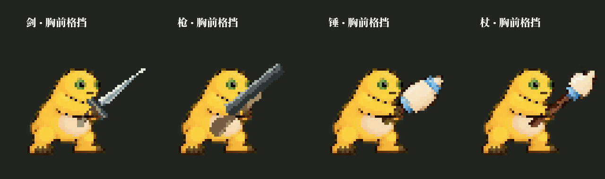
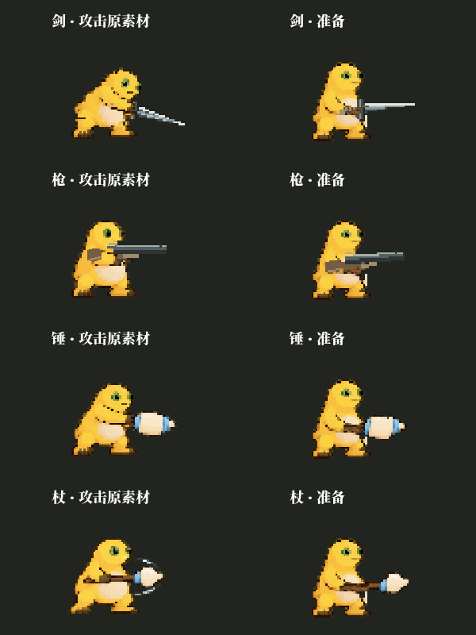

# 格挡原手臂与持握修正

根据制作人追加意见，格挡的肩臂与手掌全部沿用现有攻击素材，取消擦除原手臂后用线条补画的做法。准备、举起、就位分别使用 hammer_1 的第4、3、2帧原身体；四种武器共用动作。头身、轮廓、比例、原色板与原生像素密度保持一致。

完全就位时双手留在胸前，武器位于身前，角度以合理持握为准，不限定横向或竖向。握柄及枪身完整保留，仅原掌指实际接触握柄处遮挡，避免用整条手臂或胸腹遮掉武器主体。锤柄和杖柄按同款武器在攻击帧中的可见部分与原色板补全。





运行时使用 guard_v3 下12张完整人物PNG。格挡代码时序与规则不变：举起全过程精准格挡，就位维持默认减伤50%，解除中正常受击。

验收覆盖：未遮挡肩臂的原像素色板与轮廓、原手掌接触范围、握柄及枪身完整显示、就位高度、四种武器共用帧数及真实受击阶段。日志见 work/guard_arm_fix/ 与 work/rpg_update/。


```text
IMPORT_EXIT=0 DIAGNOSTICS=0
单元测试：848/848
RPG EXPANSION: 87 PASS, 0 FAIL
REFINE V5: 18 PASS, 0 FAIL
SMOKE_EXIT=0 DIAGNOSTICS=0
```
