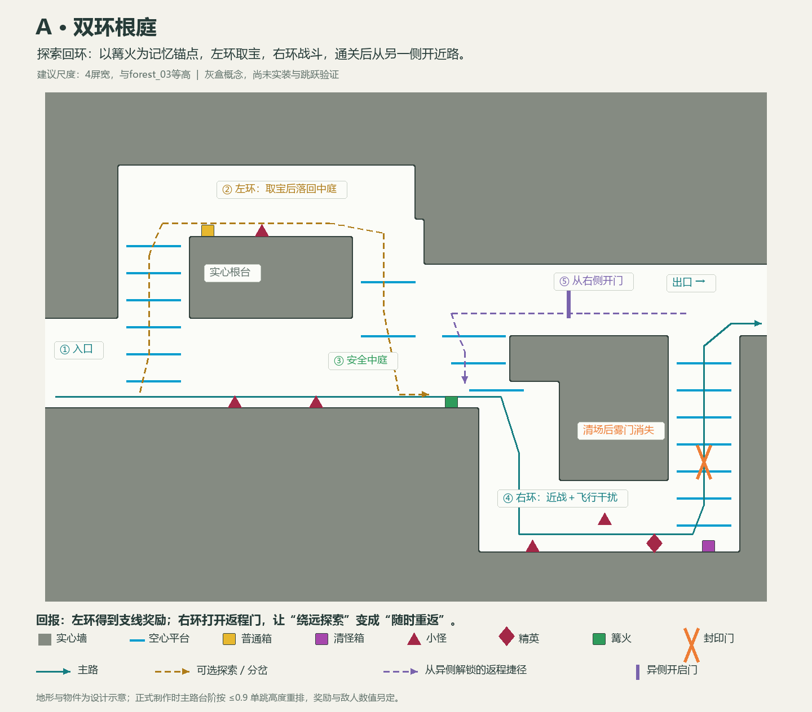
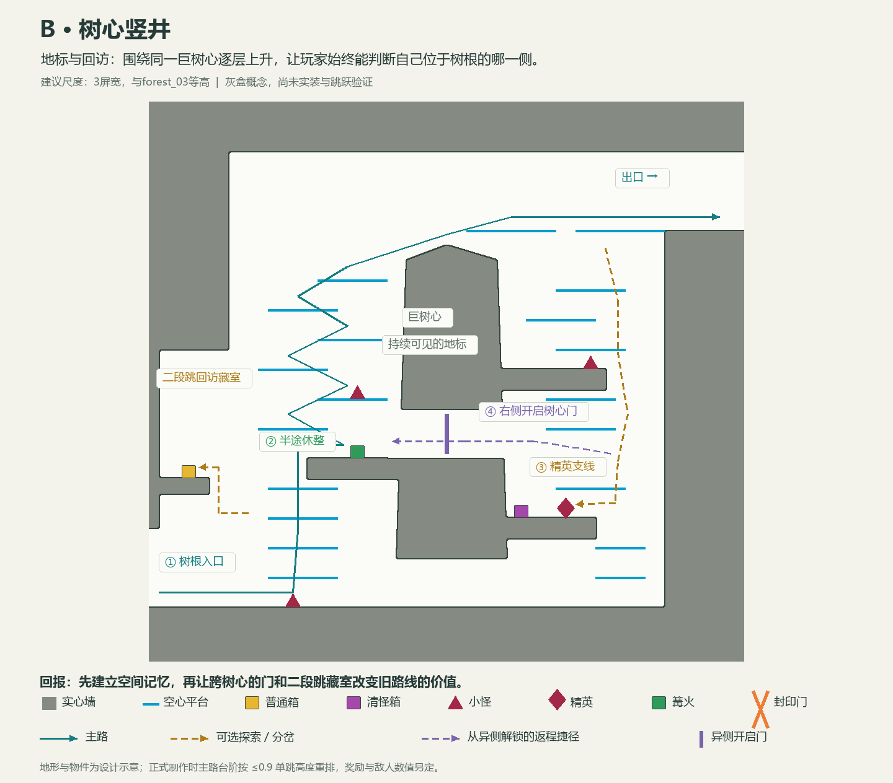
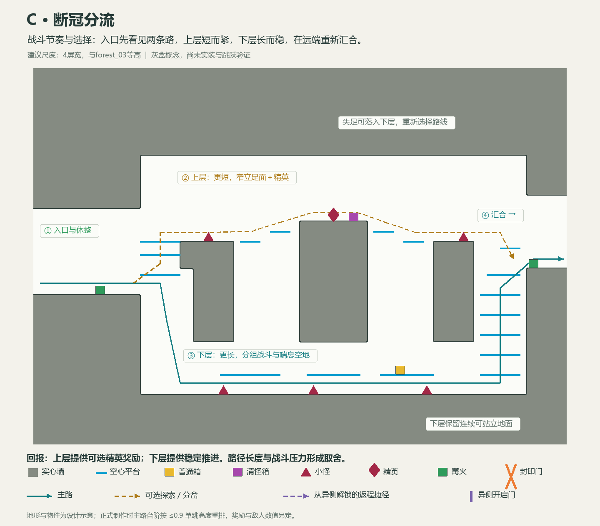

# 地图设计梳理与三张独立概念草图

> 状态更新（2026-11-13）：制作人已否决A、B、C三稿。下文保留原始讨论记录，三稿及原有优先级建议均不作为后续实施方案。问题复盘与新的设计方法见[捷径与垂直结构研究](../../maps/关卡设计复盘-捷径与垂直结构-2026-11-13.md)。

2026-11-12。范围是现有营地、forest_01～03的设计总结，以及三张后续关卡候选。新图是空间与路线示意，尚未生成Godot场景或变更地图连接；建议尺寸用于比较体量，正式制作仍需灰盒、镜头、跳跃与战斗实测。

## 现有地图的设计思路

以当前 `data/maps/*.json` 为准，旧制作文档中的“未放怪”“预览房”等历史描述不代表现状。

| 地图 | 主空间与路线 | 主要作用 | 可以继续发展的地方 |
|---|---|---|---|
| camp_01，1280×640 | 安全下层串联交谈、篝火和补给；两级薄台引到上层交易平台；右侧单出口 | 介绍交互、服务和基本上下穿越，作为稳定的归宿 | 用NPC、炉火、帐篷等地标帮助记忆功能位置 |
| forest_01，1280×1856 | 窄而高的树干空间，从根部向篝火层攀爬；下层捷径由后续区域另一侧开启 | 介绍竖向探索和跨图回环，让上升具有方向感 | 让高处提前露出目标，攀爬途中增加形态不同的落脚区 |
| forest_02，2768×1808 | 宽幅多层回廊、竖井、洞厅、宝箱支线；一个机关联动两门；上下双通道接前后图 | 扩大探索规模，用机关与回环建立区域联通 | 让不同洞厅具有可辨识地标，强化大空间与窄连接段的节奏差异 |
| forest_03，2560×1808 | 底层进场，经右侧上升、中层折返、左侧爬升抵达上层；奖励回廊与清怪雾墙穿插 | 把探索路线与小怪、精英、守箱和解封结合，并形成返回02的上方捷径 | 给玩家更多可选择的遭遇，减少连续横廊与等距阶梯带来的相似感 |

已经形成的有效规则：

1. 用实心地形分出可辨识的洞室，薄平台承担局部爬升和穿越。
2. 入口、篝火、出口与返程捷径构成可记忆的路线骨架。
3. 支线有宝箱、场景发现或连接回主路的回报；远行后开启近路本身也是奖励。
4. 主路按角色当前能力设计。现有单跳约112.36像素，正式新图的台阶升高仍控制在0.9倍以内，之后使用真实角色验证。
5. 森林统一苔岩、盘根、巨树背景与植物色板；装饰支持辨路，角色和敌人保持清楚可见。

## 参考作品：哪些来自资料，哪些是本项目的设计建议

《空洞骑士》开发者在访谈中强调空间关系要连贯、区域之间要有足够连接；发现连接以及遇到独特景象本身就有探索价值。制作上先搭出可跑的地形，再通过试玩调整间距。[Team Cherry开发者访谈，PC Gamer](https://www.pcgamer.com/how-to-design-a-great-metroidvania-map/)

《死亡细胞》主设计师Sébastien Bénard的开发日志介绍了固定世界关系、手工房间块与结构图的组合；宝藏、交易、战斗房承担不同目的，并使用紧张段和喘息段组织节奏。[开发者原文，IndieDB / Motion Twin](https://www.indiedb.com/games/dead-cells/news/the-level-design-of-a-procedurally-generated-metroidvania)

以下是基于这些资料对本项目的应用建议：

- **空间记忆**：用篝火中庭、贯穿画面的树心等固定地标，让玩家能判断自己在地标哪一侧。
- **预告与抵达**：先展示奖励、锁门另一侧或高处路线，之后通过绕行、解锁、已有二段跳能力重新理解旧空间。
- **回环回报**：捷径抵达熟悉的篝火或入口附近，明显缩短后续往返。
- **房间角色**：先确定这里负责攀爬、近战、飞行干扰、精英挑战还是休整，再布置平台和敌人。
- **路径选择**：让短路和长路在战斗压力、落脚面及奖励上形成清晰取舍；主路之外保留可选挑战。
- **维持项目框架**：采用手工固定地图、当前篝火和存档机制。这一轮提案讨论空间与战斗节奏，不包含随机重组地图或死亡重开流程。

## A · 双环根庭



建议4屏宽，与03等高。入口轻遭遇后进入安全中庭；左环绕实体根台爬升取宝，再落回中庭；右环下探战场，击败组内敌人与精英后解除雾墙，爬到上层出口，并从右侧开启返回中庭的门。

借鉴重点是“绕行后认出熟悉位置”的探索满足感。左环可选，右环承接推进；篝火与远端战斗分开。新图真正的奖励同时包括物品、空间理解和永久近路。物品及怪物具体类型、数值待灰盒后确定。

[可编辑SVG](A_root_courtyard.svg)

## B · 树心竖井



建议3屏宽，与03等高。中央树心形成持续可见的地标，左侧交替攀升，到半途篝火休整，再抵达树冠出口。右侧设置可选精英支线，从右侧打开穿过树心的门后可直接回到篝火。左侧藏室作为已有二段跳能力的回访奖励，主路保持单跳可达的设计目标。

借鉴重点是空间辨认与能力回访。不同高度的实体枝台为小战斗、观察和喘息提供落脚区，平台连接这些区域。藏室的入口高度、视线窗口和隔墙必须在灰盒中验证，避免从旁路直接绕过能力条件。

[可编辑SVG](B_heartwood_shaft.svg)

## C · 断冠分流



建议4屏宽，与03等高。入口篝火之后即可判断上下两路：上路连接较少、立足面窄，安排精英与清怪箱；下路更长，保留连续实心地面，以间隔较远的小遭遇与普通宝箱维持节奏。两路在右端篝火与出口汇合。上路失足可落入下路，能继续推进，也能返回分岔重选。

借鉴重点是战斗节奏和主动选择。上路挑战可选，图中没有通关必须清除的全图封锁。正式制作时应检验怪物射程、落地安全区与平台间距，让难度来自可观察的遭遇组合。

[可编辑SVG](C_split_canopy.svg)

## 建议优先级与素材

以下为2026-11-12旧稿判断，现已撤回：当时建议下一张优先试B，认为中央地标和纵向绕行能改变探索节奏。但图中未证明侧向出口的用途、各阶段的路线变化、实际镜头里的地标可读性及能力条件，不能据此推进实装。

三图沿用制作人的色标：灰墙、蓝薄台、黄普通箱、紫清怪箱、红三角小怪、红菱形精英、绿篝火、橙叉封印门；额外用青箭头表示主路、黄虚线表示支线、紫虚线表示解锁返程，紫门线表示异侧开启门。路线箭头表达行进方向，不是精确跳跃轨迹。

PNG和SVG由同一组矢量几何绘制。`concepts.json`是可编辑的几何与标记源，`draw_maps.py`负责制图；未引用现有素材，也未使用AI位图生成。本目录通过`.gdignore`排除引擎导入。重绘：

```text
python docs/concepts/2026-11-12_map_studies/draw_maps.py
```

仅新增设计资料，不改动运行时代码、数值表、存档与实际场景，因此本轮未启动Godot或重复执行游戏测试。
