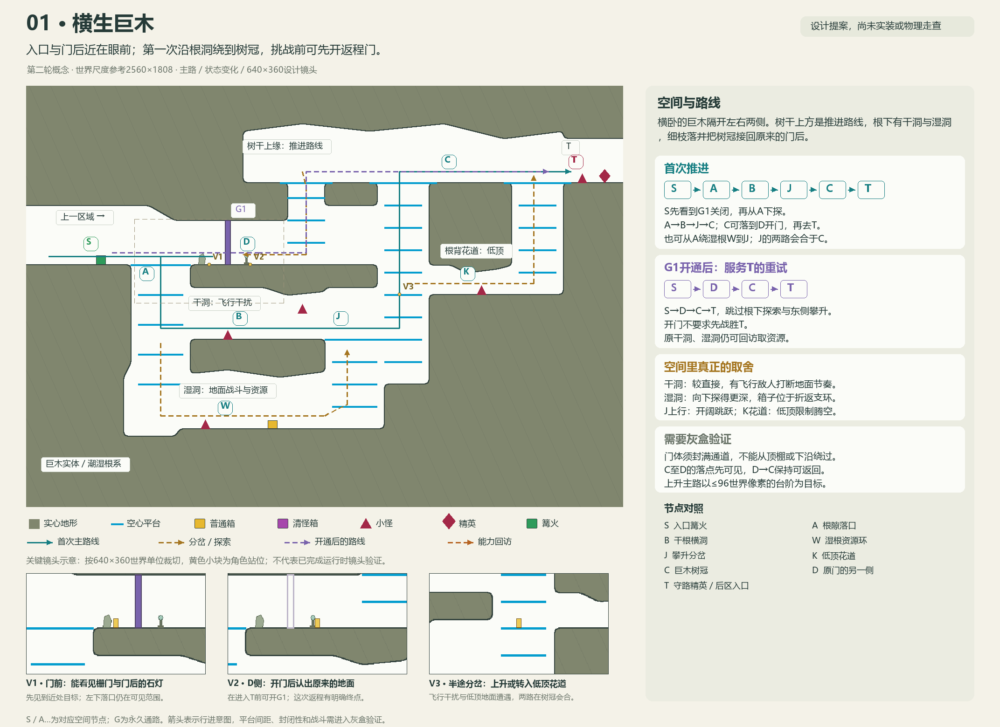
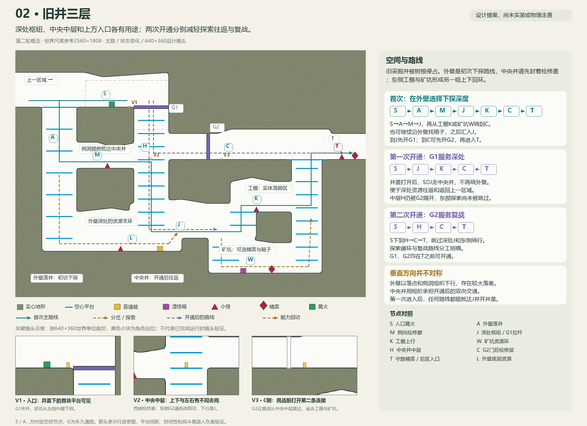
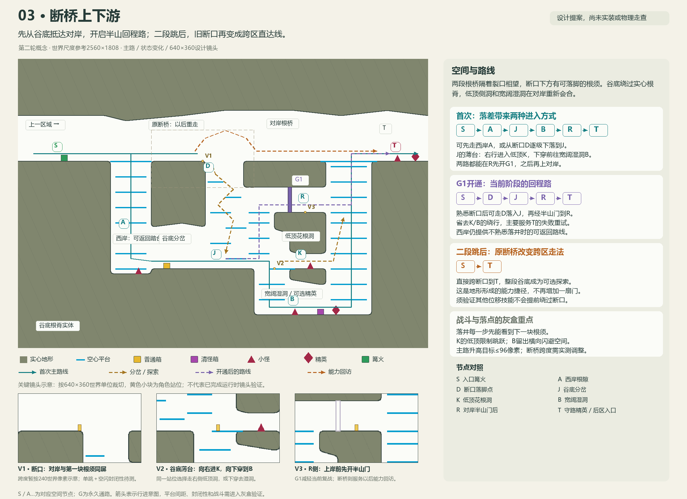

# 第二轮：三版地图提案

2026-11-13，状态：待制作人评审。与已被否决的11月12日三稿分开保存。本轮只新增独立设计资料，不修改运行场景、世界连接、存档、角色能力或平衡数值。

三版都以2560×1808世界单位作为可比较的参考体量；剖面为1:2比例。下方三个镜头按640×360世界单位从同一剖面裁切，黄块仅表示角色站位，未模拟当前摄像机的跟随与提前量。

## 方案差异

| 方案 | 空间来源 | 首次探索的决定 | 捷径具体服务什么 |
|---|---|---|---|
| 01 横生巨木 | 横卧巨木隔开近处两侧，根洞通向树干上方 | 根下干/湿分岔；上升途中选择开阔踏台或低顶花道 | 从树冠落到原门背后，在T挑战之前打开G1；以后从入口直达门后，再经短攀升回树冠 |
| 02 旧井三层 | 被树根侵占的旧采掘井，外壁落井、中央交通井、东部工棚/矿坑 | 中途从检修廊提前进中央井，或继续向下找资源；J之后再选择工棚或矿坑 | G1打开中央井盖，服务深处往返；G2连通中层与挑战前沿，进一步跳过J和东部绕行 |
| 03 断桥上下游 | 根桥裂口与谷底根脊，远近两岸有真实高低关系 | 从西岸踏台往返，或从断口根须逐级下落；同一薄台右行进低顶洞/下穿去湿洞 | G1提供当前阶段的半山复战路；二段跳后跨过原断桥，整段谷底成为可选探索，改变跨区走法 |

所有图中的T均是“守路精英与后区入口”，作为后续推进的明确目标；开门点均在T之前可达。敌人图标只表达地面、飞行、固定攻击点及精英遭遇的空间意图，具体类型、数量、奖励与强度仍需实测和制作人调整。

## 01 · 横生巨木



从入口篝火S可以先走近G1，看到门后石灯和相邻地面，但不能从这一侧开启。根隙A位于左下可见范围，初访下探后可走干洞B，或继续落到湿根资源环W，两路在J会合。

J的两条上行路径由实际空间条件区分：一侧在开阔井中应对飞行干扰；另一侧经过K，顶棚压低后限制完整跳跃，但允许地面撤退。两路在树冠C会合。K的有效低顶设置在侧洞中段，连接井本身保持足够高度。

到C后可以先沿短落井到D，打开G1，再回C挑战T。玩家也可以先尝试T，之后回头开门。开通后S→D→C→T，根下探索段与东侧长攀升被跳过；旧洞室的资源仍可回访。

镜头V1核对近处门与远侧石灯；V2核对开门后是否能认出原有地面；V3展示上升与侧洞入口，不假定能从同一个镜头看见整棵巨木。

[PNG](01_fallen_trunk.png) · [SVG](01_fallen_trunk.svg)

## 02 · 旧井三层



入口S的中央井盖G1先关闭。初访从外壁A下探，可以在M横向进入中央井，也可以继续下探到外壁资源区L。两种方式均能到达深处枢纽J，不要求二段跳，也不要求先打赢T。

J的拉杆打开G1，中央井成为直接连接S与深处的双向交通。井盖下的第一块平台在入口设计镜头中可见；中央井的较短台阶负责回程，外壁则利用落差组织第一次下行。图中没有将外壁大落差误标成基础单跳上行路线。

从J可经工棚K或矿坑W到东侧，再向上抵达C。C侧可以先打开G2，然后去T。此时复战路线变成S→H→C→T，深处J和东部绕行都可以跳过。两个开通步骤各自解决不同阶段的往返问题。

这里的H不是单纯爬梯中点：西接旧检修廊、下接J、上接入口、东经G2连接C。对应关系在中层镜头和右侧状态图中一起标出。

[PNG](02_old_shaft.png) · [SVG](02_old_shaft.svg)

## 03 · 断桥上下游



靠近断口的V1镜头中可以看见对岸和下一块根须。断口暂以240世界像素跨度表达设计意图；还没有验证单跳、空中闪避、土狼时间、上台辅助和其他位移技能的组合，因此不能把这个数值当成已成立的能力门参数。

初访可从西岸踏台A进入谷底，也可主动从断口D逐级下落到J。断口路径顶部具有较大落差；其余落点增加中间根须，让下一步落脚面能进入设计视口。西岸提供基础能力可返回的踏台路线。

谷底分岔落在同一块薄台上：右行进入低顶K，下穿前往更深的宽阔湿洞B。K在中段压低顶棚，影响跳跃走法；B保留横向闪避与地面战斗空间，并将精英和清怪箱放在可选资源区域。两路都在R会合。

R侧先打开G1，再上岸去T。此时熟悉断口的玩家可以S→D→J→G1→R→T，省去低顶洞或深处湿洞的绕行。二段跳之后再回访，原断口成为S→T的地形捷径，整段谷底从推进路径转为可选探索。两类捷径的开通条件和用途不同。

[PNG](03_broken_bridge.png) · [SVG](03_broken_bridge.svg)

## 本轮检查与边界

已进行：

- 条件连接图检查：各门开启点在目标挑战前可达，关闭和开启后的路径确实不同，开通后跳过了声明的区域。
- 图上检查：主路和分岔箭头没有穿过实体或提前穿过关闭的门；设计镜头站位具有地面或薄平台支撑。
- 低顶检查：在K节点按草图剖面扣除34世界像素参考碰撞身高后，剩余上升空间低于112.36像素参考单跳高。这个检查只证明几何意图，不代替碰撞实测。
- SVG格式检查和三张PNG视觉检查。

结果见[结构检查](结构检查.md)。没有填写虚构的通行耗时，也没有把抽象图的节点数当成真实路程或风险。

尚需在制作人选定方向后做灰盒：每段跳跃的横纵余量与顶棚碰撞、角色全部位移组合、单向落差的返回、门体封闭性、敌人射程/追击/落地空间、实际镜头跟随，以及开门前后的复战耗时。主路上升台阶以≤96世界像素作为起始布置目标，再用真实角色调整。

## 编辑与重绘

`plans.json`是几何、门、状态连接和镜头站位的可编辑源。`draw_plans.py`输出PNG和SVG；主剖面、对象与文字保持矢量，SVG中的三个镜头为从同源图生成的嵌入预览。

```text
python docs/concepts/2026-11-13_round2/draw_plans.py
python docs/concepts/2026-11-13_round2/review_plans.py
```

本目录由`.gdignore`排除引擎导入。本轮未变更游戏运行逻辑，也未启动Godot或重复执行游戏单元测试。设计依据为[捷径与垂直结构复盘](../../maps/关卡设计复盘-捷径与垂直结构-2026-11-13.md)，旧三稿仍保留否决状态。
