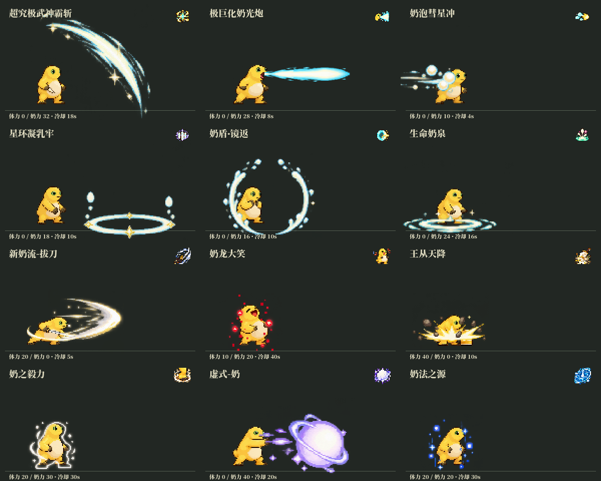
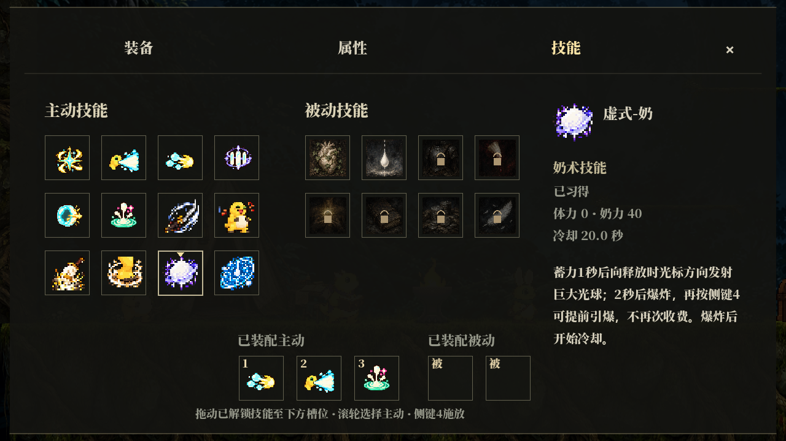

# 十二技能接入 · 2026-10-28

制作人本次要求将合作者上传的十二招导入，替换旧主动技能与六个主动占位；另已批准未定规则先使用数据表中的试玩临时值。本次按最新决策覆盖开发计划书旧五招的数量、获取与操作描述。两项已实现被动及其预留栏目保留，坐火技能天赋页仍待后续制作。

## 使用

I → 技能，左侧十二招均可拖入下方三个主动槽。滚轮切换槽位，鼠标侧键 4 施放。极巨化奶光炮按住侧键蓄力、松开发射；奶盾·镜返按住维持、松开收盾；虚式-奶发球后再次按同一招可引爆。拔刀要求剑，王从天降要求锤；不满足武器、资源、地面或冷却条件时不施放、不扣费。

为便于本轮试玩，十二招暂全部可装配。新角色默认装配彗星冲、奶光炮、生命奶泉。旧存档沿槽位映射：奶泡弹→奶光炮，剑气→拔刀，奶盾→镜返，挤奶冲击→王从天降，治疗→奶泉，星乳坠落→霸斩；映射后去除重复与失效 ID。旧被动、背包、点数和仓库数据保留。

| 技能 | 当前效果 | 消耗（体力 / 奶力） | 原始冷却 |
|---|---|---:|---:|
| 超究极武神霸斩 | 五次0.5倍短斩、一次1.75倍终结斩 | 0 / 32 | 18秒 |
| 极巨化奶光炮 | 三级蓄力，1.4/2.4/3.6倍奶术；同目标一次，遇墙裁短 | 0 / 14、20或28 | 8秒 |
| 奶泡彗星冲 | 地面突进110px，1.2倍物理；无无敌，遇墙临崖停止 | 0 / 10 | 4秒 |
| 星环凝乳牢 | 生成和消散分别0.6/0.4倍奶术；普通目标先定身再减速 | 0 / 18 | 10秒 |
| 奶盾·镜返 | 正面32点吸收，展开0.18秒精准窗口、一次近战反击及30%来源反弹 | 0 / 16 | 10秒 |
| 生命奶泉 | 同地面范围内每秒恢复8%最大生命，共四次 | 0 / 24 | 16秒 |
| 新奶流-拔刀 | 0.2秒架势受击免除本次伤害，位移居合，无视防御 | 20 / 0 | 5秒 |
| 奶龙大笑 | 狂击20秒：伤害+30%、承伤+20%、击杀回血 | 10 / 20 | 40秒 |
| 王从天降 | 真实跃起与快速下砸，2.5倍物理；普通敌人眩晕3秒 | 40 / 0 | 10秒 |
| 奶之毅力 | 忍耐10秒：减伤30%，禁止闪避 | 20 / 30 | 30秒 |
| 虚式-奶 | 蓄力1秒，光球接触伤害，飞行2秒或再次按键引爆 | 0 / 40 | 爆炸后20秒 |
| 奶法之源 | 奥术20秒：物理普攻转奶术并保留原基底，原奶术普攻+10% | 20 / 20 | 30秒 |

冷却受感知影响，奶力消耗受已有减耗加成影响。技能前摇中断不收费；提交后不退费。已提交招式按各自后摇窗口衔接闪避和普攻。增益不写入存档，死亡和切房清理临时状态、光球和场地；已提交光球被回收也开始冷却。

## 素材与实现

- 来源索引：`assets/PROCESSED/skills/catalog.json`，SKL-B01 / SKL-NB01 各六招。
- 保留96张原角色帧、96张独立特效帧、十二套原图标及六个奶光炮组件；没有重绘或覆盖合作者原图。
- B01角色锚点为(48,90)，NB01为(48,84)，分别读清单，角色保持原生尺寸和完整逐帧。脚底继续映射玩家节点+(0,17)。
- `data/skills.json`：正式技能、图标、消耗、冷却、描述和旧 ID 映射。
- `data/skill_runtime.json`：技能阶段、伤害事件、范围、控制、增益、蓄力档位与试玩临时值。
- `data/skill_presentations.json`：两批原素材路径、帧序、锚点与SHA-256；`python tools/assets/build_skill_library.py`可重建，不修改图片。
- `PlayerSkills`控制阶段和提交，`SkillEntity`承载光束、光球和场地，`SkillArt`播放原特效；`SkillControl`实现敌人定身、减速与眩晕。伤害都经过受击框、归属去重及世界遮挡检查。
- 原普攻、剑三段接触轮廓、四类武器格挡和按住移动方式保留。技能素材按需加载缓存，维持项目60FPS上限。

## 临时规则

以下为制作人批准的试玩参数，集中在`data/skill_runtime.json.provisional`和各招配置，后续可直接调表：

- 拔刀2倍，索敌280px、位移最多160px，碰墙停止；无目标时仍免触发的本次伤害，但不位移。
- 下砸2.5倍，范围76px；精英和首领不眩晕，不改变地形碰撞。
- 光球速度190px/s、接触0.65倍，每目标间隔0.5秒；爆炸3.2倍、范围76px，穿敌不穿墙。
- 狂击与忍耐互相替换；狂击击杀恢复按最大生命30%计算，覆盖近战、远程普攻与技能来源的击杀。奥术可与它们并存。
- 原设计未定空中施放的招式本轮统一从地面起手。

原始设计与包manifest中的“候选/尚未接入”保留作为交付时记录；当前接入状态以本文和运行时数据为准。

## 预览与验收





验证包括完整素材清单及原图哈希、真实物理空间的逐招施放、资源提交/取消、墙体裁短、技能回奶去重、镜返来源、增益互斥/到期、远近程击杀回血、地面治疗、光球接触/引爆/贴墙出生/切房清理和鼠标拖装。

```text
导入检查：exit=0，ERROR/WARNING=0
冒烟启动：exit=0，ERROR/WARNING=0
单元测试：1005 / 1005，RESULT: ALL PASS
TWELVE SKILLS: 72 PASS, 0 FAIL
RPG EXPANSION: 87 PASS, 0 FAIL
RPG OVERHAUL: 44 PASS, 0 FAIL
GAMEPLAY SYSTEMS: 76 PASS, 0 FAIL
COMBAT REGRESSIONS: 18 PASS, 0 FAIL
NATIVE DRAG: 0 failures
REFINE V5: 17 PASS, 0 FAIL
SIM RESULT: ALL PASS（32/32）
数据校验：66项通过，0错误
```

预览使用隐藏窗口、15FPS、内存与时限看护。该次图像导出峰值约270MB，技能专项运行约165MB；工具结束后不留游戏进程。
