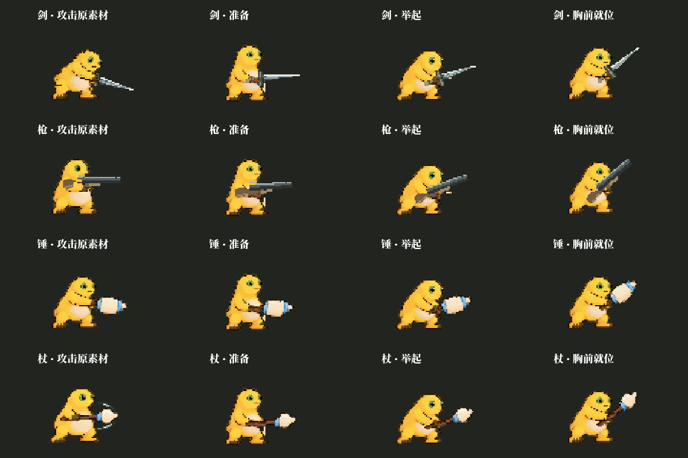
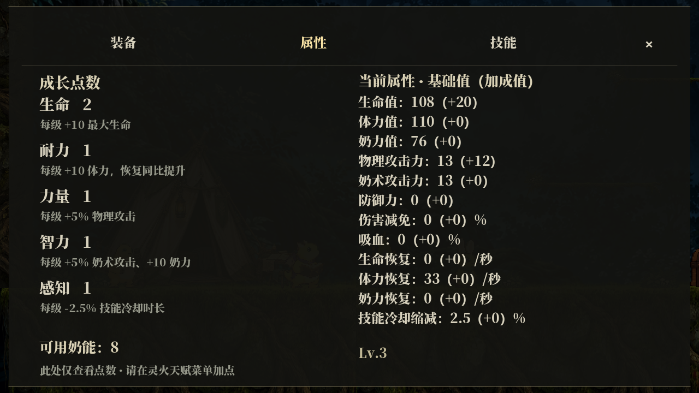
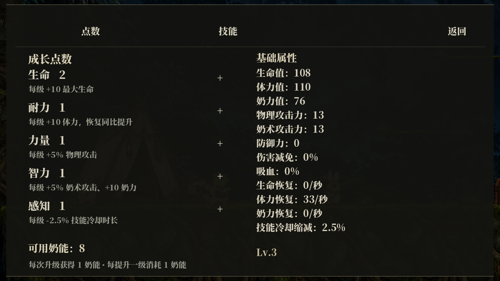
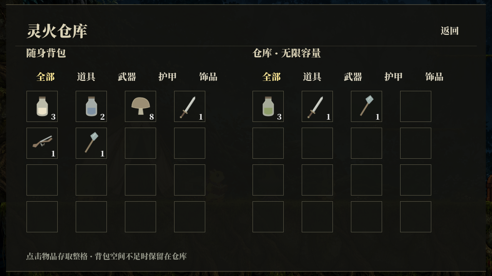
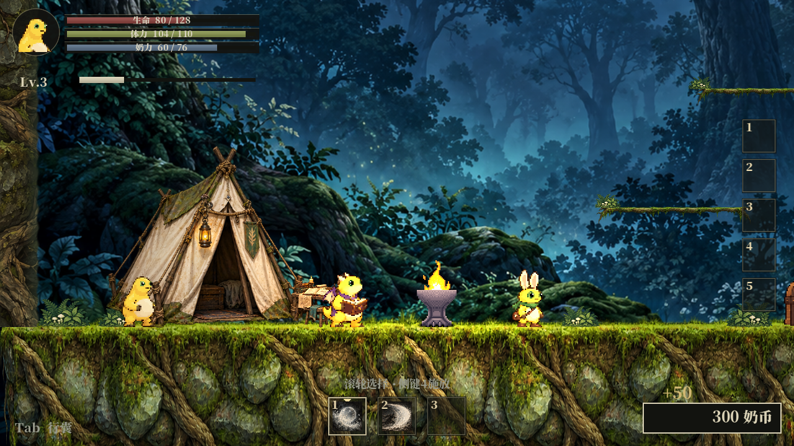

# 格挡、成长与仓库更新（2026-10-28）

按本次制作人要求完成七项系统更新，并根据追加意见重做四类武器格挡外形。

## 格挡

格挡肩臂与掌形直接保留现有攻击动作，维持帧在胸前持握。只在掌指接触处遮挡武器，保留完整握柄与枪身；角度按合理持握确定，不限定横竖。详见 [原手臂与持握修正](../art/格挡原手臂与持握修正-2026-10-28.md)。

剑、枪直接复用原攻击的武器绘制；奶瓶锤、奶杖直接提取现有攻击帧中的武器像素，保持原比例和配色。运行时播放四类各3张完整人物PNG。共用身体动作与时序：0–0.2秒举起，全部属于精准格挡；0.2秒就位，持续按右键维持，初始减伤50%；松键立即进入0.18秒解除动作，解除中正常受击。原有体力与破防规则保留。



## 成长与属性

每次角色升级获得1奶能，每奶能提升任意点数一级。生命+10最大生命；耐力+10最大体力且体力恢复同比提升；力量+5%物理攻击；智力+5%奶术攻击和10最大奶力；感知缩短2.5%技能冷却时长。角色原有自然等级成长保留。

I属性页左侧只查看点数，右侧显示基础值（+额外值）。坐火天赋菜单顶部为点数/技能两页：点数页左侧可加点，右侧实时显示基础属性；技能页保留占位。旧存档迁移、奶能和点数持久化已接入。




## 状态栏、输入与仓库

左上为数字等级及经验条；奶币移到右下边框内，收入或支出短暂跳出对应正负金额。A/D与左右方向键按住移动、松开减速停止；移动时转向，攻击时按鼠标侧转向。数字1–5直接使用已经登记到对应快捷槽的道具。

坐火仓库左右两侧独立筛选全部、道具、武器、护甲、饰品。点击堆叠直接转移；背包没有接收空间时完整保留仓库物品。仓库可持续增加内容并滚动查看。当前护甲、饰品没有新增道具内容，已有/未来对应类型均沿统一通路存取。




## 突刺特效

第三段剑击沿剑刃加入收束的破风线与剑尖冲击光，并增加发力阶段的可见强度。实际接触轮廓从剑身与所有剑光生成，保持2像素外扩容差、空白区域不伤害、同一目标一次攻击只命中一次。

## 验证

导入、单元、真实鼠标加点/存取、数字键1–5、四类武器格挡阶段、等级/奶能/存档、技能冷却、伤害轮廓、拖拽与菜单回归由本地测试覆盖。逐项输出记录在 `work/rpg_update/`；本次结果如下：

```text
IMPORT_EXIT=0 DIAGNOSTICS=0
单元测试：807/807
RPG EXPANSION: 87 PASS, 0 FAIL
RPG OVERHAUL: 45 PASS, 0 FAIL
GAMEPLAY SYSTEMS: 76 PASS, 0 FAIL
COMBAT REGRESSIONS: 18 PASS, 0 FAIL
REFINE V5: 18 PASS, 0 FAIL
NATIVE DRAG: 0 failures
SWORD CONTACT PHYSICS: 33 PASS, 0 FAIL
SWORD CHAIN: 8 PASS, 0 FAIL
NATIVE CHARACTER MOTION: 17 PASS, 0 FAIL
SIM RESULT: ALL PASS（32/32）
数据校验：66 项，0 错误
SMOKE_EXIT=0 DIAGNOSTICS=0
```
