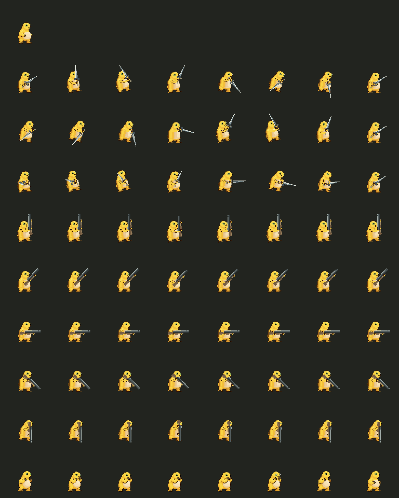
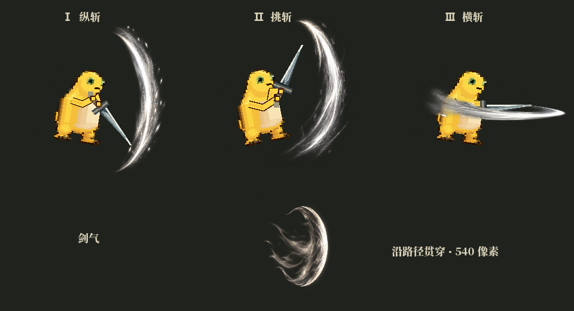
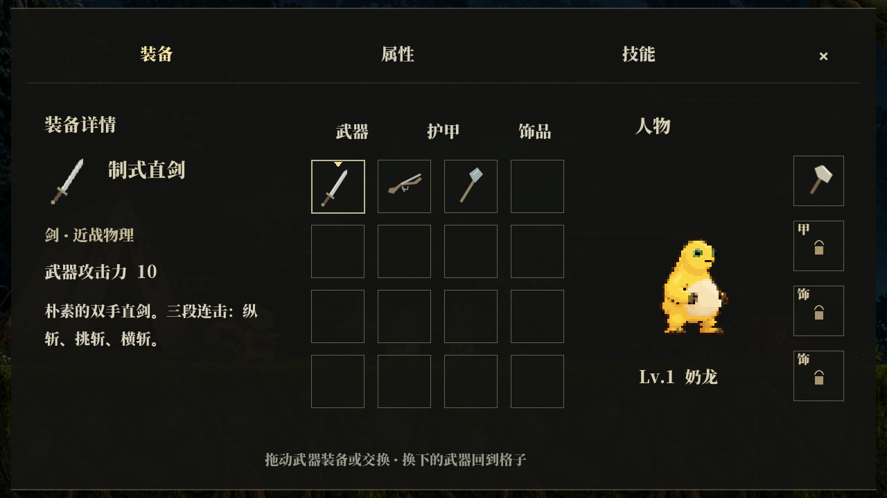
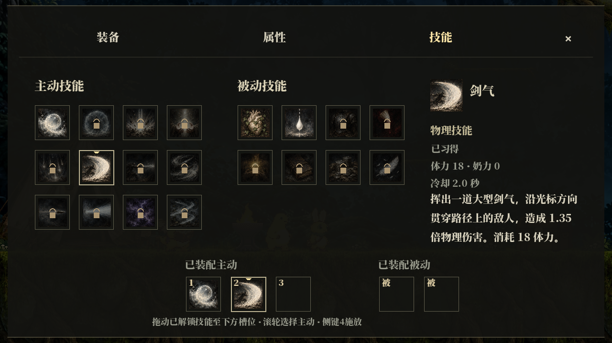
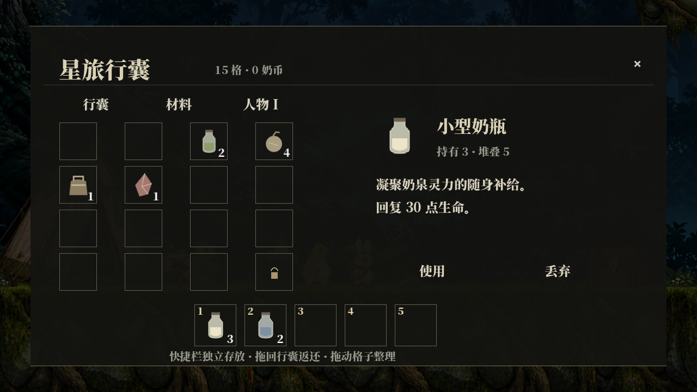

# 直剑、步枪、剑气、格挡与简约界面

制作人本轮决策：弓模组替换为步枪；已有斩击技能替换为贯穿剑气；界面改为克制、低饱和的暗色奇幻风格。本说明补充早期计划中的弓与界面约定。

## 动作

人物继续使用 CHR-01 的正式闲置原图，头、身体、眼睛、腹部斑纹不重新生成，人物贴图不缩放。只替换原手臂区域，并用原图取色重绘两条运动中的手臂；不会同时保留旧手和新手。完整人物绕脚底转移重心，保持与原动作相同的像素密度。

三段直剑分别为上向下纵斩、下向上挑斩、横向挥斩。剑有对称直刃、中脊、十字护手、长握柄和简朴配重，两只手握在同一剑柄上。纵斩从过顶准备挥至身侧；挑斩反向上挑；横斩使用握点横移和剑身透视长度变化。大幅挥动需要更多武器留白，因此导出画布由 64×64 扩展为 96×96，人物本身未放大。挂点为 [48,84]。

步枪为双手持握的朴素单发武器，枪托、机匣、护木、准星和枪管分别绘制。左右朝向和俯仰连续跟随光标，两只手共用枪械握点。瞄准计算补偿人物中心与枪口的位置差，使弹道沿实际枪管飞向光标。一次按下左键射击一发，按住可保持瞄准，松开结束；无需蓄力。原 `bow_01` 和 `milk_gun` 标识保留以兼容已有装备存档，游戏内名称、分类、图标和行为均已替换为步枪。

原始素材：`assets/PROCESSED/characters/CHR-01/v001/`。新动作配置：`data/hero_motion.json`；64 张导出检查帧：`assets/PROCESSED/characters/CHR-01/rpg_v5/`。



## 刀光与剑气

纵斩、挑斩、横斩分别绘制了独立的四帧图集，分别向下、向上、横向展开，不再复用同一个刀光。播放位置、镜像、伤害窗口仍随实际武器模组控制，锤和杖保留原动作与特效。

技能“旋刃打击”改为“剑气”，逻辑 ID 保持 `skill_cleave` 以保留已有解锁和装配。消耗仍为 18 体力，造成 1.35 倍物理伤害；单独绘制的大剑气以 460 像素/秒飞行，最大距离 540 像素，视觉大小 86×100，判定 36×76。贯穿路径上的敌人，每名敌人只结算一次，碰到实心墙结束。

纹理与生成提示：`assets/effects/sword_v5/`；实现：`scripts/player/sword_wave.gd`；数值入口：`data/skills.json` 与 `data/combat_presentation.json`。



## 格挡

按住右键依次播放原举手帧，最后暂停在完全举起双手的第 3 帧（索引 2）。不继续播放放下部分，也不循环整套动作。任意阶段松开，防御判定当帧结束，并从当前高度立即开始放下双手；结束后回到自由状态。完美格挡窗口及原防御数值保留。

## 界面

去掉厚金属边框、宝石与高亮雕花，使用半透明深色底、低饱和细线、衬线文字、留白和轻微悬停底色。覆盖标题、HUD、装备、属性、技能、行囊、暂停、对话、坐火、仓库和天赋界面，并重新绘制简洁光标。

物品与武器采用同套简洁轮廓图标；20 个主动、被动图标使用新生成的油画图集。物品、技能格的拖拽、装配、使用、丢弃与详情交互继续保留。技能图标与框架分离，避免装饰吞掉内容。

皮肤配置：`data/ui_skin.json`；原生控件：`scripts/ui/quiet_frame.gd`、`scripts/ui/rpg_skin.gd`；图标和提示词：`assets/ui/quiet_v5/`。







## 验证

`tools/test_refine_v5.gd` 验证长按与提前释放格挡、旧装备存档接入步枪、原母版密度、两只持枪手、连续俯仰、枪口弹道、剑气多目标贯穿与单目标去重、实心墙阻挡、独立刀光纹理与新图标。现有战斗、人物面板、拖拽、坐火和地图回归同时保留。

预览只使用单个隐藏且限制 15 FPS 的渲染辅助进程，均有超时和自动退出；测试存档隔离在工作区。重新导入后可通过根目录 `run_game.cmd` 启动试玩。

最终本地输出（Godot 4.7.2 / Windows）：

```text
IMPORT_EXIT=0 DIAGNOSTICS=0
=== 汇总：passed=680 / total=680 ===
RESULT: ALL PASS
REFINE V5: 18 PASS, 0 FAIL
COMBAT REGRESSIONS: 18 PASS, 0 FAIL
RPG OVERHAUL: 45 PASS, 0 FAIL
GAMEPLAY SYSTEMS: 76 PASS, 0 FAIL
NATIVE DRAG: 0 failures
数据校验：66 项检查，0 错误
SMOKE_EXIT=0
```

标题及十种游戏界面、人物动作与三段刀光预览全部导出成功，渲染日志无错误或警告。测试验证逻辑和素材接入，动作与界面的美术效果仍以上方图片及实际试玩为准。
