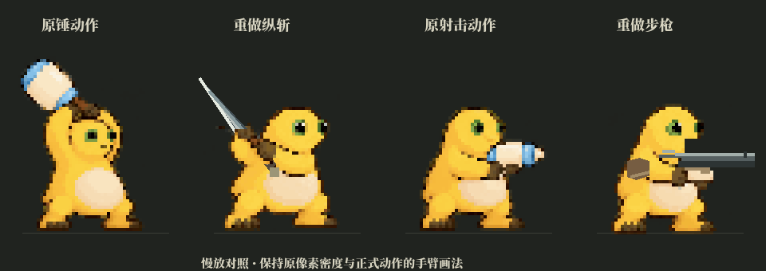
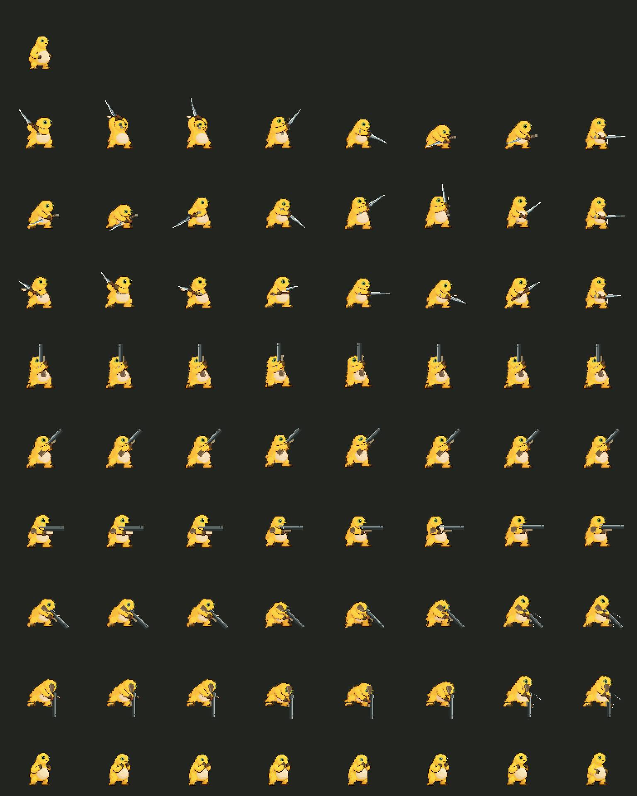

# 角色动作联动与原生手臂修正

本轮针对制作人指出的两点修正：固定闲置身体配程序手臂，缺少身体发力；线段和方块画出的手臂、手掌与原动作不一致。

## 当前做法

取消程序线段手臂、方块手掌与闲置腹部补色。直接使用正式 `hammer_1/2/3`、`staff_sweep`、`blaster_fire/charge` 的人物帧。手臂轮廓、手掌、阴影、眼睛与身体来自这些原始帧；原始 v001 文件不修改，人物贴图以 1:1 像素密度使用。

重新按原图逐帧标定握点和旧武器遮罩，遮罩不能覆盖原手掌。新武器在原握点绘制，原掌层在相同纹理坐标和变换下恢复武器前方的掌形，不绘制额外手臂。

- 纵斩：原过顶蓄势 → 抬肩 → 前挥 → 俯身下压 → 收招。
- 挑斩：原俯身低位 → 转移重心 → 上挑 → 举手 → 收招。
- 横斩：原侧身蓄势 → 转肩 → 伸展挥击 → 身体跟随 → 回位。

每段使用至少五个正式姿态。头肩、躯干和下肢支撑共同换帧，不能用旋转一张闲置图冒充身体动作。

平射步枪沿用原 `blaster_fire` 的预备、射击、后坐、恢复姿态；上下瞄准结合正式抬手或俯身姿态，上身与原手臂一同调整。腿部保留相应正式帧，上身俯仰修正限制在约 12 度，避免瞄准时把整个人转成横躺。连续瞄准、左右转向、枪口弹道、三段独立刀光和剑气玩法继续保留。

## 对照

下图为同倍率慢放，依次是原锤动作、新纵斩、原射击动作、新步枪。对照采用实际 Godot 渲染帧，FFmpeg 只负责 GIF 编码。



完整逐帧表：原闲置、三段剑击、五方向步枪、原格挡。



## 资源与重建

- 正式源图：`assets/PROCESSED/characters/CHR-01/v001/frames/`。
- 当前动作配置：`data/hero_motion.json`，`native_motion.version = 6`。
- 当前渲染器：`scripts/player/pixel_hero_rig.gd`。
- 导出检查帧：`assets/PROCESSED/characters/CHR-01/rpg_v6/`，64 张 96×96 PNG；画布留白不改变人物原始密度。
- 逐帧导出：`tools/preview_hero_rig.gd`。
- 慢放渲染：`tools/preview_native_motion.gd`，24 帧保存在被忽略的工作目录，再以 12 FPS 编码为 GIF。
- 原图对照：`tools/preview_reference_attacks.gd`。

预览使用单个隐藏的 Godot 渲染辅助进程，限制 15 FPS，设超时并自行退出。没有自动打开试玩实例。

`tools/test_native_motion.gd` 检查三段的头肩与下肢确实换帧、原手掌未被遮罩覆盖、不含程序手臂方法、五方向枪械身体换帧、握点重合、腿部不随枪口翻转。自动检查不能代替对动作观感的评审。

最终本地输出（Godot 4.7.2 / Windows，测试存档隔离）：

```text
IMPORT_EXIT=0，ERROR/WARNING=0
=== 汇总：passed=680 / total=680 ===
RESULT: ALL PASS
NATIVE CHARACTER MOTION: 17 PASS, 0 FAIL
REFINE V5: 18 PASS, 0 FAIL
COMBAT REGRESSIONS: 18 PASS, 0 FAIL
RPG OVERHAUL: 45 PASS, 0 FAIL
数据校验：66 项检查，0 错误
SMOKE_EXIT=0
```

全部渲染辅助进程退出码 0，渲染日志无错误或警告。各姿态共用着色器，仅通过参数切换遮罩和绘制层，避免每次换帧重新编译不同着色器。
