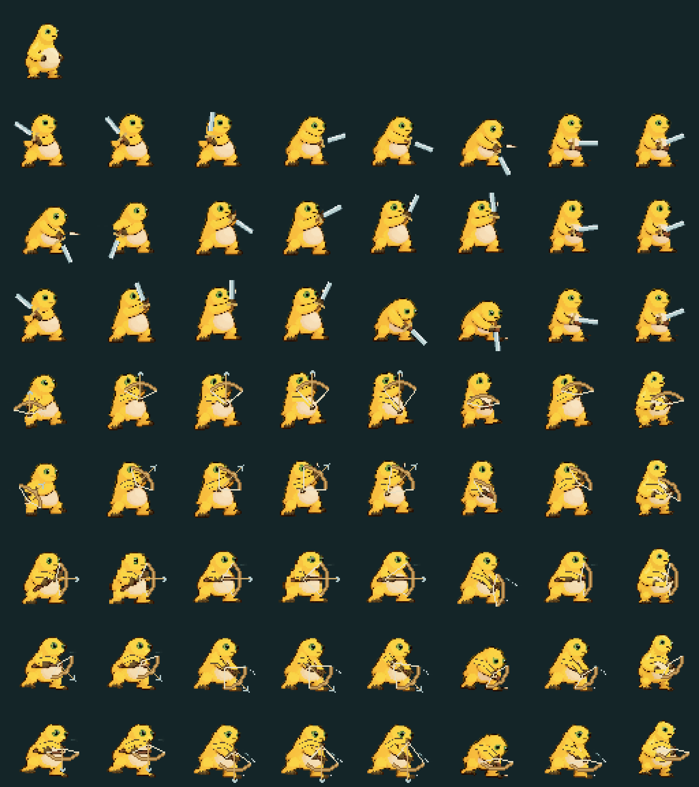
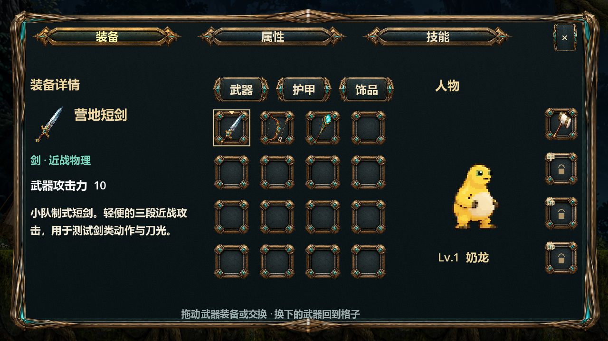
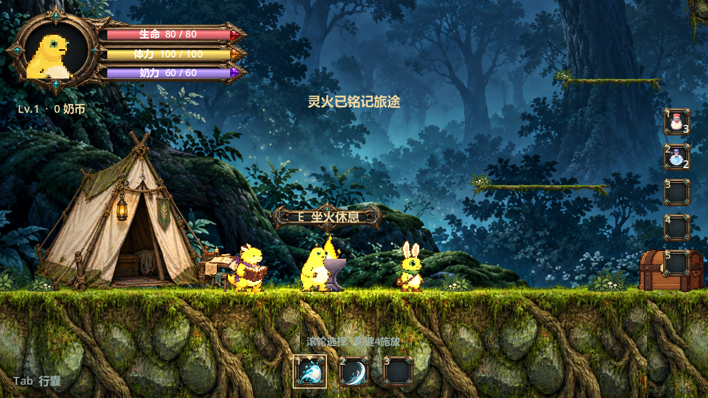

# 战斗、动作一致性与 UI 修复

## 战斗与敌人

原近战特效有一个带形状的 Area2D，但实际扫描伤害的 HitboxComponent 是另一个无形状的子 Area2D。因此会播放特效却扫描不到敌人。现在形状、扫描和开窗都在同一个 HitboxComponent 内。真实锤击、三段剑击、弓箭和杖弹均经物理碰撞验证扣血与击杀，不再仅通过直接调用伤害入口验收。

怪物受伤显示生命条及延迟血量、短暂闪光、实际伤害飘字和命中特效，玩家保留顿帧与屏震。死亡奖励只结算一次，死亡身体不继续阻挡。伤害仍使用原防御和抗性公式。

感知改为近距离、同层高度和无遮挡视线三项共同判断：起始 144 像素，追击保持 208 像素；地面高度差起始 42、保持 58。实体出生先巡逻，不再直接进入全图追击。两种敌人实现共用感知规则。

移动检查身体前方的真实地面碰撞，而非把某一段平台或巡逻区间当作追击障碍；相连的实心、空心平台均可通行，真实悬崖前折返。保留受击被击退离开平台的可能。

双方身体掩码加入对方，人物不会穿过活敌人。接触后以 170 像素/秒反弹 0.14 秒，冷却 0.32 秒，不自动扣接触生命；受敌人攻击仍走正常受伤逻辑。跳跃可从上方越过，闪避也不会取消实体碰撞。

数值入口：`data/encounter_rules.json`；主要实现：`enemy_awareness.gd`、两类敌人、`attack_effect.gd`、玩家接触处理。

## 角色一致性与剑弓

最初生成的人物稿和后续拆分头身的版本均已弃用，未作为本次正式资源。最终实现直接使用原 CHR-01 完整闲置、锤、杖人物帧作母版，禁止添加背鳍、重新上色或切割拼接头身。

正式攻击素材有 96×96 画布，角色本体的像素密度与闲置相同；按原脚底锚点裁到 64×64，人物不缩放。角色预备、扭转、俯身与收招取自完整正式姿势，新剑武器、连击节奏单独制作。弓按上、平、下方向选择完整抬手或俯身姿态，后手、弦、弓身和出箭点连续跟随光标，拉弓过程中向左移光标也立即更新人物朝向。

素材位于 `assets/PROCESSED/characters/CHR-01/rpg_v4/`，共 64 张 64×64 PNG。对照图顶部为原闲置，随后三行剑和五行方向弓。运行时瞄准不是仅五个固定角度。姿态来源与挂点见 `data/hero_motion.json`，时序见 `data/combat_presentation.json`。

## 交互提示和界面

原先固定在屏幕底部的交互提示改为待交互对象上方的金属文本框，随相机变换。篝火、宝箱、NPC、拾取物和机关均按实际 E 键优先级显示唯一目标；菜单和对话中隐藏，原场景的重复裸文本提示停用。

新绘制的锻金、深色皮革、青绿宝石材质已用于标题、HUD、行囊、人物、技能、暂停、坐火、天赋、仓库、对话、格子、按钮、武器及技能图标和光标。框角保形，正文区细粒底纹；血、体、奶三条使用分层高光。所有文字和操作仍为原生控件。

原画及完整生成提示词在 `assets/ui/forged_v3/README.md`，切片和布局由 `data/ui_skin.json` 管理。新 UI 预览为 `docs/previews/rpg_*_v3.png`。

## 验证方式

未自动打开可供游玩的实例。逻辑回归采用无图形模式，预览仅使用单个隐藏渲染辅助进程，限制 15 FPS 并设置退出超时；测试存档隔离在工作区。

`test_combat_regressions.gd` 在无图形环境中仅注入确定的瞄准输入，使用真实玩家状态、碰撞、近战和投射物链路。覆盖四种武器、受击反馈、上下瞄准、同层视线、混合平台、身体反弹和跳跃绕过。`test_rpg_overhaul.gd` 检查导出画布、完整正式母版 RGBA、人物面板、双资源技能、独立快捷栏、保存迁移及物体上方提示。其余地图、拖拽和坐火回归继续运行。

对照图和实机界面：







## 本地验证结果

Windows / Godot 4.7.2，所有测试存档与普通游玩存档隔离。导入与测试输出：

```text
导入检查：exit 0，ERROR/WARNING 0
=== 汇总：passed=680 / total=680 ===
RESULT: ALL PASS
COMBAT REGRESSIONS: 18 PASS, 0 FAIL
RPG OVERHAUL: 45 PASS, 0 FAIL
GAMEPLAY SYSTEMS: 76 PASS, 0 FAIL
CAMP REDESIGN: 31 PASS, 0 FAIL
FOREST ENCOUNTERS: 26 PASS, 0 FAIL
森林物理、营地森林通道、原生拖拽：0 failures
数据校验：66 项检查，0 错误
无图形冒烟 120 帧：exit 0，无 ERROR/WARNING
```

8 个界面预览（装备、属性、技能、行囊、暂停、对话、坐火、HUD）均已实际渲染检查。角色主观形象一致性请通过上方对照图评审，自动测试不代表制作人已批准美术。
