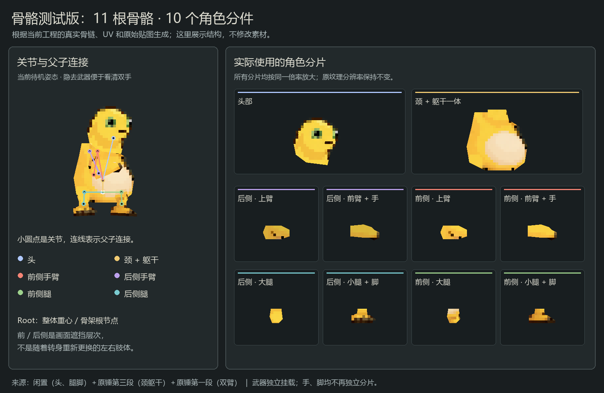
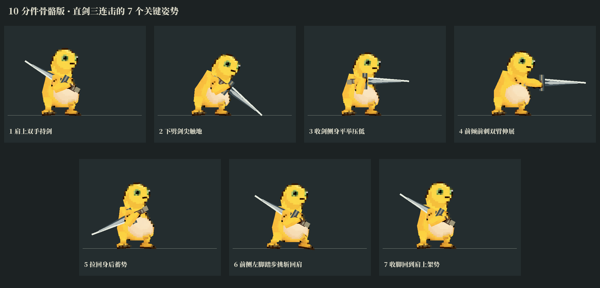

# 骨骼动画测试版

这是一套可独立试玩的 2D 骨骼原型。主游戏默认仍用原逐帧动画，运行期间可切换展示方案；切换不重置角色状态、战斗计时、碰撞、装备或存档。

## 测试入口

- Windows 双击根目录 `run_skeleton_test.cmd`；Linux 使用 `./run_skeleton_test.sh`。启动分辨率 1280 × 720，限制 60 FPS。
- 实验台左侧显示现有逐帧/攻击素材，右侧显示骨骼版本。可选择动作、武器、速度，暂停并拖动时间轴，或显示骨架。
- 实验台“骨骼试玩 → 主标题”进入骨骼试玩；“逐帧试玩 → 主标题”恢复逐帧试玩。之后按正常流程继续游戏。
- 游戏中 **F6** 切换展示，**F7** 显示骨骼和 IK 目标。Esc 菜单也有切换按钮；对话中的任意键推进优先。
- 本次进程保留选择，退出后恢复默认逐帧。也可使用 `-- --animation-backend=skeleton` 或 `-- --animation-backend=frames` 指定启动方案。

## 素材与动作

直接引用 CHR-01 正式素材的静态纹理：闲置第 1 帧的头和腿脚，原锤第 3 段第 1 帧的颈躯干，以及锤第 1 段第 2 帧的手臂。保持原图及原始纹理分辨率；没有重新生成角色形象，没有增加背鳍。最近邻采样用于保留像素边缘。分片旋转、弯曲后的轮廓仍需美术审看，当前是动作与绑定测试版。

按制作人最新指定的六类方案，11 根原生 Bone2D 驱动 10 个 Polygon2D 分片：头 1、颈躯干一体 1、双侧上臂各 1、双侧前臂手一体各 1、双侧大腿各 1、双侧小腿脚一体各 1。额外的一根 Root 骨只控制整体重心。颈、手、脚不再有独立的蒙皮分件或 Bone2D。

躯干有多骨权重过渡。双臂、双腿使用原生 TwoBoneIK；四个手脚末端保留 Marker2D 定位点，用于计算握点与脚端位置，不独立弯折合并的前臂手或小腿脚。武器挂在手端定位点上，枪口与可见枪管一致。骨骼模式的角色子树没有 AnimatedSprite2D，纹理不会按动作换帧。隐藏的旧精灵暂停，切回后恢复当前动作进度。

共 22 个 AnimationPlayer 动作：原有 21 个基础/武器动作，加上直剑专用的肩上持剑待机 `sword_ready`。剑三段现为下劈、前刺、踏步挑斩，包含头身重心和双手联动；步枪按光标方向连续俯仰并联动头身。测试武器用于验证挂点，锤、杖外观仍为简化形状。

## 直剑七个关键姿势

1. 双手握剑，剑身斜搭左肩。
2. 从肩上直接向下劈，剑尖最终接触脚下地面。
3. 收剑到身侧，剑身平举、身体压低，准备刺击。
4. 身体略向前倾，双手向前伸展完成平刺。
5. 身体摆正，将剑收回身后蓄势。
6. 前侧左脚向前踏步，剑从身后挑斩，回到肩上。
7. 收回前脚，恢复与第一步一致的肩上架势。

这里把前侧腿固定作为动作中的左腿。持剑时单独设置双肩投影与两手握距，使前刺时两臂均接近伸直。压身主要作用于颈躯干，支撑脚保持中性落地；第三段才进行前脚踏步与重心前移。

双臂每次实际执行原生 IK 的两个分支，分别选择世界坐标中更低的肘点。轨迹同时避开肩部折叠奇点，伸臂保留微小余量，限制反关节；密集测试还要求肘部实际不高于肩部，并检查相邻时点没有突跳。完整三连击的相邻准备姿势一致；骨骼直剑等待本段后摇完成后衔接，逐帧仍使用现有衔接时机。单独停止在第一、第二段后，会在表中规定的 0.14 秒内平滑回肩，按最短等价角旋转。

关键时间、七姿势的几何约束和回归容差都在 `data/skeleton_test.json` 的 `sword_sequence` 中。





## 在 Godot 中编辑

打开 `scenes/player/skeletal/hero_skeleton_test.tscn`，选中 Skeleton2D 编辑骨链/静止姿态，选中 Polygon2D 编辑 UV 和权重，选中 AnimationPlayer 编辑动作曲线。动画保存在 `assets/PROCESSED/characters/CHR-01/skeleton_test/hero_bone_animations.tres`。控制点在 `Controls`，前手的 `WeaponMount` 是武器挂点。

`data/skeleton_test.json` 保存初始分片、骨链、曲线、IK 和瞄准参数。`tools/build_skeleton_test.gd` 用 Godot 原生 API 生成资源。它默认拒绝覆盖已有场景；只有明确传入 `-- --force` 才会从表重建，并覆盖场景和动画库中的手工修改。修改编辑器资源后不要直接强制重建。

实现依据：[Godot 2D 骨骼教程](https://docs.godotengine.org/en/4.4/tutorials/animation/2d_skeletons.html)、[Polygon2D 蒙皮 API](https://docs.godotengine.org/en/4.2/classes/class_polygon2d.html)、[TwoBoneIK API](https://docs.godotengine.org/en/4.4/classes/class_skeletonmodification2dtwoboneik.html)。实际运行验证使用本机 Godot 4.7.2。

## 回归入口

除工程原有导入、单元与冒烟检查外，新增独立脚本：

```text
godot --headless --path . --fixed-fps 60 --script res://tests/skeleton_prototype_check.gd
```

专项覆盖真实骨骼/蒙皮/曲线、原图引用、双手与脚底 IK、五倍缩放、步枪十向瞄准及真实子弹枪口、攻击中往返切换、坐火进度、暂停按钮和对话优先。测试使用隔离的用户数据目录，不写入正式存档。

2026-10-27 本机验证输出（Godot 4.7.2）：

```text
IMPORT_EXIT=0                    无 ERROR / SCRIPT ERROR
baseline_units: 680 / 680        RESULT: ALL PASS
current_workspace: 723 / 723     RESULT: ALL PASS
SKELETON PROTOTYPE: 198 PASS, 0 FAIL
validate_data: 66 / 66
main_smoke_EXIT=0                120 帧
lab_smoke_EXIT=0                 120 帧
```

当前工作区另含并行的逐帧剑动作及启动性能修改，工作区宿主已通过 723 条。为避免最终验证读到正在生成的另一版逐帧图片，再使用原提交配置与本次骨骼文件的固定快照验证 680 条基线用例和 198 条骨骼专项。并行改动未混入本次提交。实验台截图与动图由 Godot 实际渲染，未自动启动前台试玩实例。


